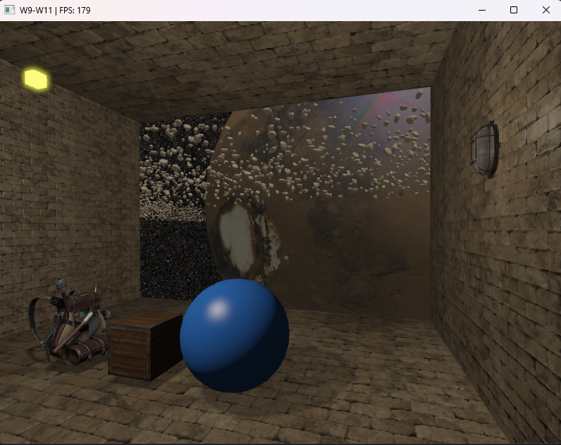

# Observatory Scene

## Weekly progress

- Weekly updates are available in "learning_logs"

## Learning material

| Material | Status |
|---|---|
| Fundamentals of Computer Graphics, Fifth Edition | 🟡 |
| Ray Tracing in One Weekend Book Series | 🔴 |
| [CMU Computer Graphics Lectures](https://youtube.com/playlist?list=PL9_jI1bdZmz2emSh0UQ5iOdT2xRHFHL7E&si=knAZi4WGLnnt8G_z) | 🟢 |
| [LearnOpenGL](https://learnopengl.com/) | 🟡 |

## Topics in need of review

- First pass & second pass
- Geometry shader
- G-Buffer
- Instancing
- Gamma correction
- Bloom