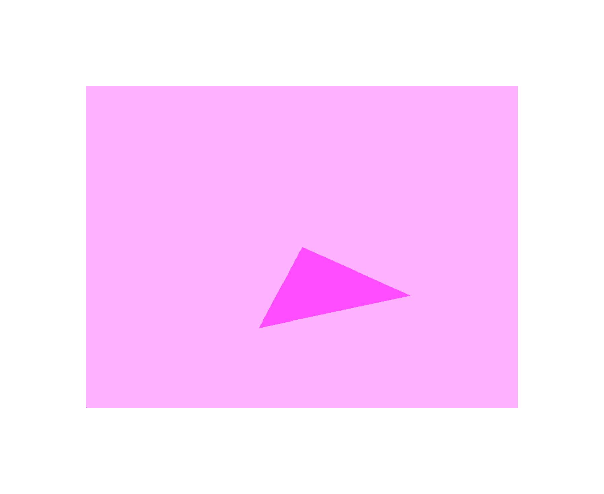
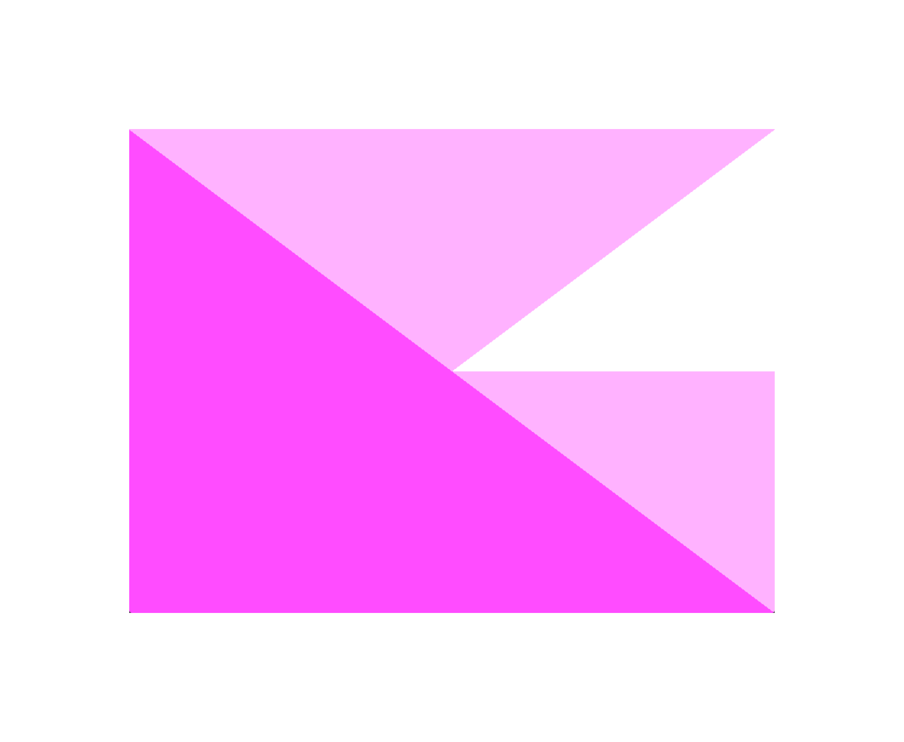

# Week 1 (30.3-5.4.2026)

## I learned:

- how to setup the context with glfw, glad, visual studio and openGL
- to make my first triangle on the screen

- understood that data travels from CPU --> OpenGL --> GPU
- there is a front and back buffer that creates a frame buffer?
- a lot of OpenGL and graphics programming terminology
- the basic pipeline (vertices --> VBO --> VAO --> shader program --> render loop)

## I struggled with:

- with a lot of very basic syntax
- understanding which functions comes from which library, and what they do
- positions from -1.0f to 1.0f thinking
- .glsl file implementation
- (most things)