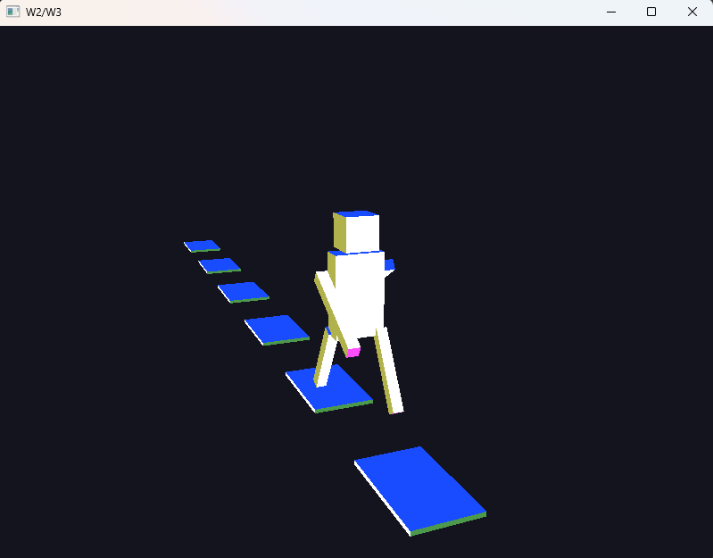

# Week 4 (20.4-26.4.2026)

## I learned:

- creating the frustrum with the (projection * view * model) matrix multiplication in the vertex shader (order is critical)
- about perspective and orthogonal projection matrices
- to create tiles that appear when they enter the view matrice area?

## I struggled:

- rotating the camera according to my needs ( how to get objection moving at the same time as the camera so that they move relatively correctly)
- understanding how certain glm functions like glm::lookAt and glm::perspective works under the hood
