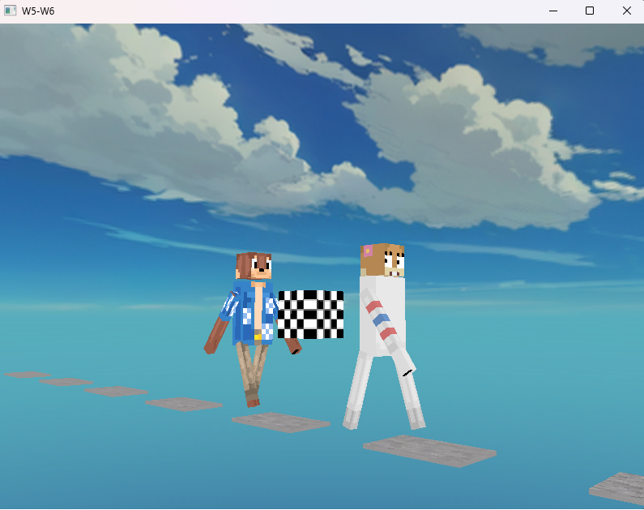

# Week 6 (27.4-3.5.2026)

## I learned:

- the basic way to implement sky textures with the skybox method ( tutorial from https://ogldev.org/www/tutorial25/tutorial25.html )

## I struggled:

- understanding how to actually render the skybox (a lot of the skybox.cpp seemed very confusing). I understood the cubemap texture side of things with the stb image library, since I already used this and studied up on it.

## Thoughts:

- felt like I really didn't grasp the entirity of the skybox setup due to losing track on the order of operations and had to lean on AI too much. I underestimated the difficulty of the implementation and should've maybe reserved more time on this.