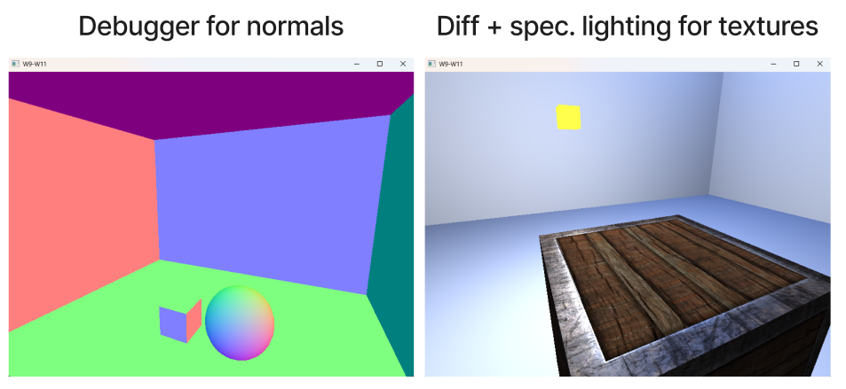
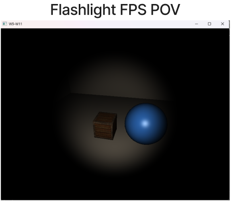
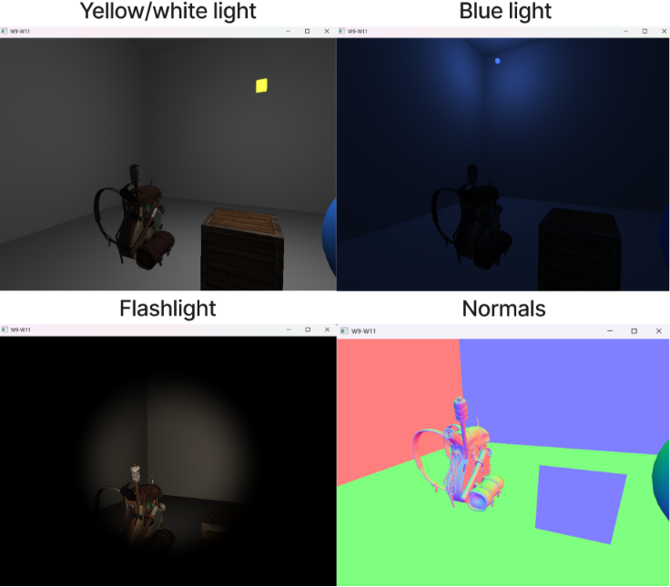
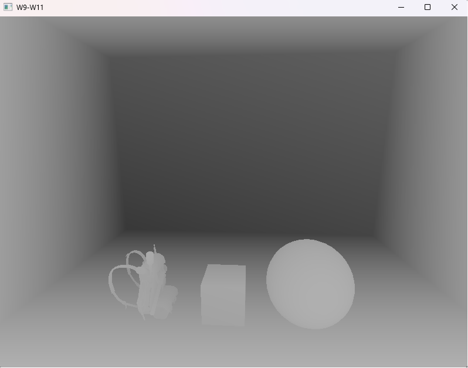

# Week 8 (22.6-28.6.2026)

## I learned:

- made a visualizer for the normals with AI to help understand where all the normals point (+X -> Red, +Y -> Green, +Z -> Blue etc..) (from [-1, 1]). Pressing N flips between debug and regular view in the scene.

- added diffuse and specular lighting for textures, so that you can have a specularity map, where some part of the material is shiny while other parts aren't

- added a flashlight light source mounted to the FPS POV that can be turned on/off by pressing F

- added Assimp library integration for mesh/model loading and loaded a detailed backpack model ( different lights + normals )

- added B&W depth testing debugger

- added stencil testing debugger feature ( toggle with key P)

- added semi-transparent windows, you can look through multiple to still see through. Key for this was to render opaque objects first, then render transparent objects from furthest to closest ( in the context of our view ). Without this trick looking through multiple windows would produce a pixel from the wrong depth (farther one vs. closer one)

- about face culling. With face culling we don't have to render all surfaces of a cube for example since at most we only can see 3 at a time, so we only render the vertices (triangle) that facing the our vision in the scene. We do this checking of the triangles by checking the winding order of the triangles in the screen space after the camera projection.

## I struggled:

- Implementing the Assimp mesh loading, I didn't understand at first that you have to create completely new shaders for the purpose also. Also even though I followed the tutorial for the model loading (model.cpp and model.h), I didn't understand the Assimp library functions and what we did most of the time.

- Keeping the code clear. At this point I'm starting to have a lot of code and probably I should be refactoring the code so that certain things like the uniforms creations wouldn't be so repetitive. Also same with the debuggers.

- Stencil testing debugger with any kind of mouse or keyboard movement with WASD. For some reason the the outline first starts disappearing partially and then the more you move it completely disappears. I tried to keep depth testing enabled ( instead of disabling it ), but that didn't work. Also tried a few different approaches, but finally gave up. The initial start screen without moving works correctly though when you press P.

## Thoughts:

- Again this week I kept on following the LearnOpenGL tutorials and used AI when I got stuck. This workflow turned out to be quite good to get a brief overview about a lot of stuff and saved time from doing a lot of repetitious stuff.