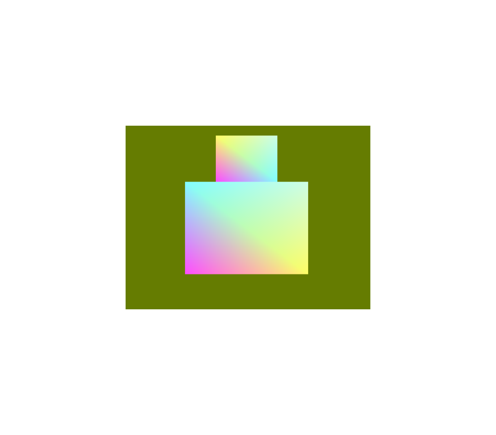

# Week 2 (6.4-12.4.2026)

## I learned:

- how to make rectangles move
- simple bouncing rectangle simulation ( moving in 2D from left to right and up and down with acceleration)

- how EBO works (with indices buffer) and why it's sometimes (most times?) better
- color gradients to triangles/rectangles and color changing depending on the pos of rectangle
- glm functions required for the most basic matrix transformations
- file organization (what's maybe the ideal way organize in graphics context)

## I struggled with:

- implementing .glsl files with the right syntax (rectangles where often black, probelm with vertex and fragment shader code)
- making the rectangle accelerate accordingly
