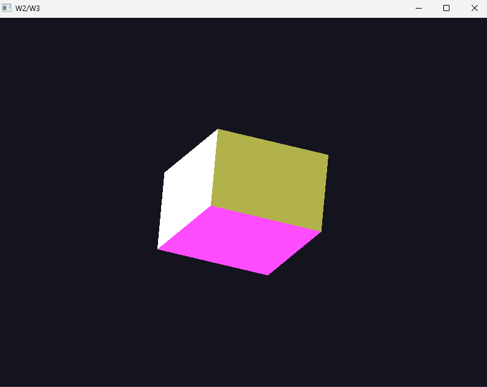
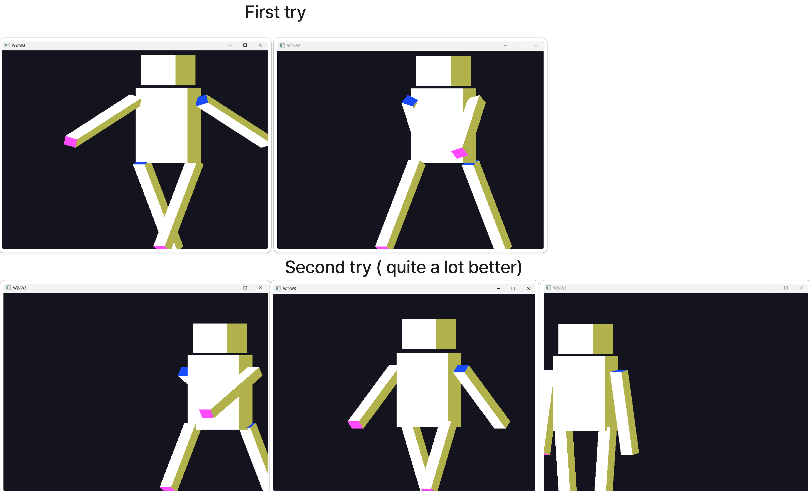

# Week 3 (12.4-19.4.2026)

## I learned:

- rotations, translations and scaling in 2D and 3D
- order of transformations matters (played around with this quite a lot)
- how to make 3D objects
- made a simple cube (connecting the whole thing together)

- how it necessary to enable the glEnable(GL_DEPTH_TEST) to actually make the cube depth (so it's not transparent)

- How to create multiple objects in a more scalable way

- How to mount objects together so that one object is a parent object to its children ( like with the character ), child transformations move relative to parent transformations

## I struggled with:

- working with 3-dimensional space, the vertices and indices were quite difficult to get right at first --> in the end the depth enabling was missing
- understanding how to have the correct order of transformations to get the type of movement you want, quite frustrating and didn't grasp this concept very deeply
- figuring out how to determine anchor points of rotations 
- understanding the theory behind the 3D transformations