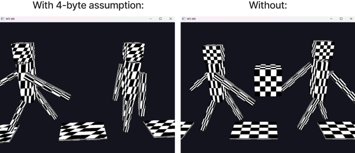

# Week 5 (27.4-3.5.2026)

## I learned:

- how to move the view with WASD and mouse by changing the camera pos and camera dir. vectors in the view matrix (free roam camera)
- how to organize multiple objects by making separate draw functions for them / making separate files to keep main.cpp for cluttering

- how to add textures to my cube and why mipmaps are important for scaling

## I struggled:

- differences between the camera position and the direction of the camera
- getting the camera pos working relative to all camera directions when moving with WASD and mouse together
    - yaw and pitch (hard to figure out first why the cosines and sines were being multiplied for horizontal movement)

- getting the texture stretched out to the cube correctly, I used a 250x250 image so I had to add in the GLPixelStorei() function to get OpenGL to not assume that 
there are 4 bytes by default in the pixel
- understanding the texture pipeline on the host side (CPU), a lot of different function calls for this

## Thoughts:

- Very happy with how I got the free camera working. Debated whether to create 1st and 3rd person camera in which you could move the character,
but for now this setup will do.

- I ended up using the stb.image inserting library in order to get my .png file to the CPU memory. It seems as if
there could be a better way to do this, since the current way feels complicated and I had to troubleshoot with AI for this setup.