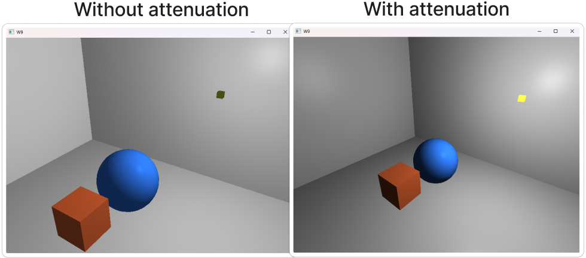
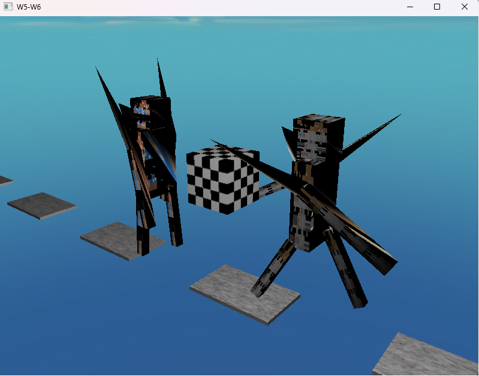

# Week 7 (14.6-21.6.2026)

## I learned:

- to implement basic ambient, diffuse and specular lighting ( used LearnOpenGL tutorial as a base for this week https://learnopengl.com/Lighting/Basic-Lighting ). Also in addition I added attenuation which takes the distance between the fragment and the light into consideration.

- one way to create spheres

- since the sphere has more normals for the light to process, it looks way smoother (flat normals vs. smooth normals)

## I struggled:

- first trying to implement the ambient and diffuse light to the moving minecraft style characters I had in my scene. There would've been a lot of other stuff I would've needed to do in order to get that working.

- with getting the surfaces reflect in a realistic way with moving light source. When you start moving the light source, it's easy to see that in some parts of the walls they reflection is either too bright or dim.

## Thoughts:

- I quickly realized that the current scene I was working with was too complex with too many moving parts. It was a good idea to a create simple training ground for the light specifically.