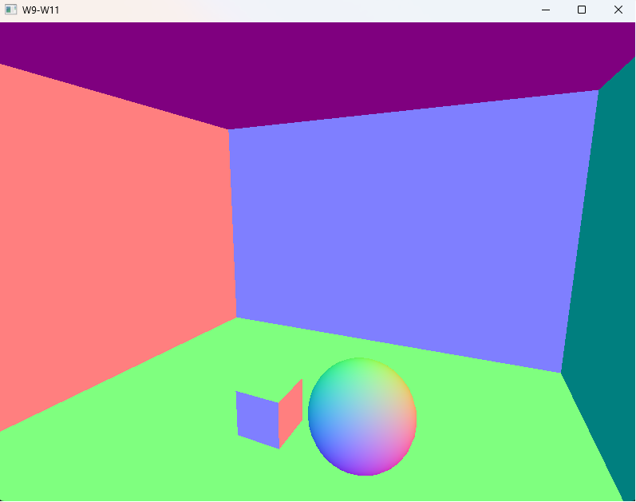

# Week 8 (22.6-28.6.2026)

## I learned:

- made a visualizer for the normals with AI to help understand where all the normals point (+X -> Red, +Y -> Green, +Z -> Blue etc..) (from [-1, 1]). Pressing N flips between debug and regular view in the scene.

## I struggled:

## Thoughts:
