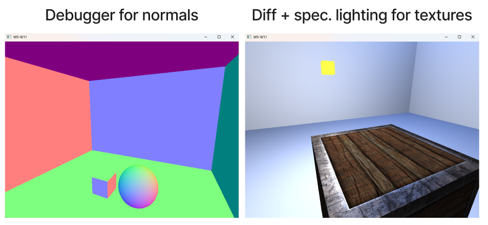
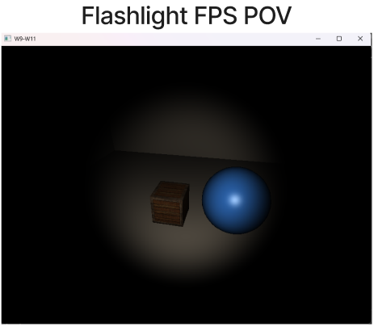

# Week 8 (22.6-28.6.2026)

## I learned:

- made a visualizer for the normals with AI to help understand where all the normals point (+X -> Red, +Y -> Green, +Z -> Blue etc..) (from [-1, 1]). Pressing N flips between debug and regular view in the scene.

- added diffuse and specular lighting for textures, so that you can have a specularity map, where some part of the material is shiny while other parts aren't

- added a flashlight light source mounted to the FPS POV that can be turned on/off by pressing F

- added Assimp library integration for mesh/model loading and loaded a detailed backpack model ( different lights + normals )

## I struggled:

- Implementing the Assimp mesh loading, I didn't understand at first that you have to create completely new shaders for the purpose also. Also even though I followed the tutorial for the model loading (model.cpp and model.h), I didn't understand the Assimp library functions and what we did most of the time

## Thoughts:

- Again this week I kept on following the LearnOpenGL tutorials and used AI when I got stuck. This workflow turned out to be quite good to get a brief overview about a lot of stuff and saved time from doing a lot of repetitious stuff.