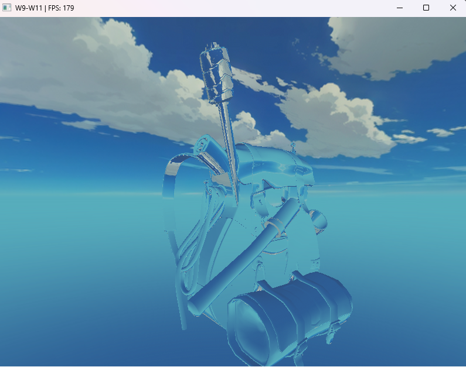
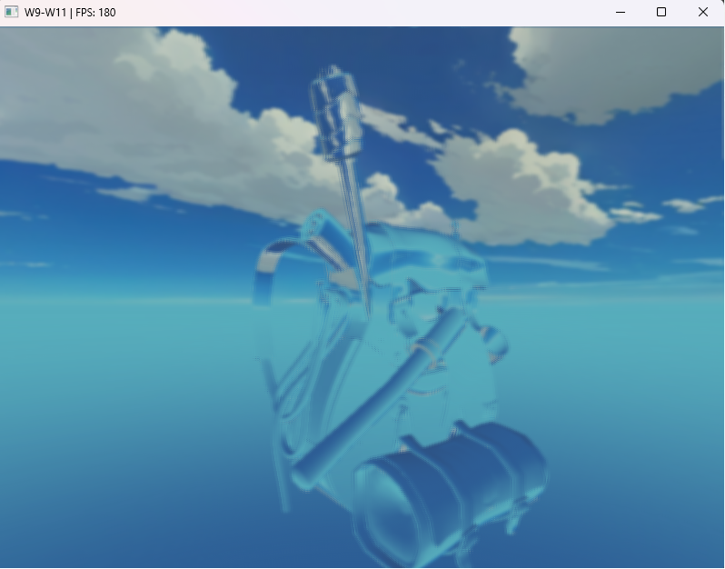

# Week 9 (29.6-5.7.2026)

## I learned:

- how to make directional light, implemented this together with my previously made skybox setup (switching between skybox/room works by pressing M key).

- how to create reflections in textures, implemented this feature on the backpack object model turning it into glass texture through refraction

- to create a blurring effect to the scene through separate framebuffer post-processing

## I struggled:

- with blurring effect implementation through framebuffer post-processing. I followed the OpenGL guide, but took quite a lot of time to figure out why instead of blurring I only got a white screen when pressing B. In the end the issue was the order of usage of shader programs, in the init function of the scene I accidentally added the screen shader function in between model shader functions, which created the incorrect pipeline.

## Thoughts:

- I implemented the skybox setup way earlier and back then didn't internalize the setup properly, it probably would've been more helpful for my learning to have added the skybox entirely at this point to get more of a grasp of the whole thing.

- I notice a lot of repetitiveness creating these new features to my scene, and feel like a lot of the steps could be abstracted at some point for enhanced workflow and code clarity. Since this is my learning repository, it maybe shouldn't be as much of a focus, but eventually I could refactor the code completely to get a more scalable result.