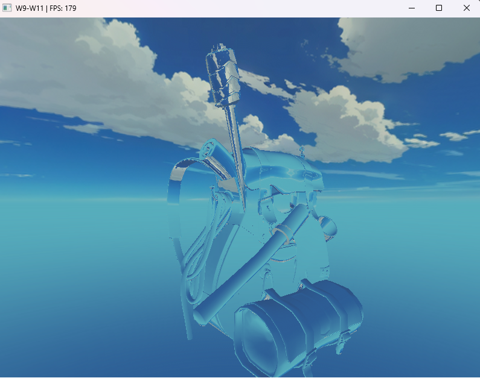

# Week 10 (6.7-12.7.2026)

## I learned:

- about interface blocks and uniform buffer objects. These are exactly the kind of upgrades I was hoping for since they make shader usage cleaner and easier to scale. Especially the UBO is essential for me since it lets me store shared uniform data in GPU memory from which multiple shaders can read. So basically instead of individually declaring the projection and view uniform matrices, we treat them as one entity.

- about geometry shaders. In the rasterization pipeline they place in between vertex and fragment shaders. The geometry shader could be used to create new shapes on the go, for example we could make rectangles out of mere primitives (dots on the screen). We could also manipulate already made models like the backpack and visualize normal vectors of each triangle.

- about instanced rendering. Instead of having separate draw calls for model and mesh of an repeated object, we first get the model matrix data and then draw the same mesh many times in one call. The render calls require CPU to GPU communication which slows the program up a lot if we have a lot of objects (for example + 1000 backpacks all moving) in the scene.

- a few tricks on how to deal with aliasing. I added 4X MSAA (multisampling) for the framebuffer making edges in certain angles appear smoother since now a pixel is split into 4 to get a more accurate color. Since I already had the custom framebuffer from the blurring effect, I had to implement the changes to the framebuffer specifically instead of the window framebuffer, this would've started analysing pixels on top of blurring which would've not made any sense.

## I struggled:

## Thoughts:
