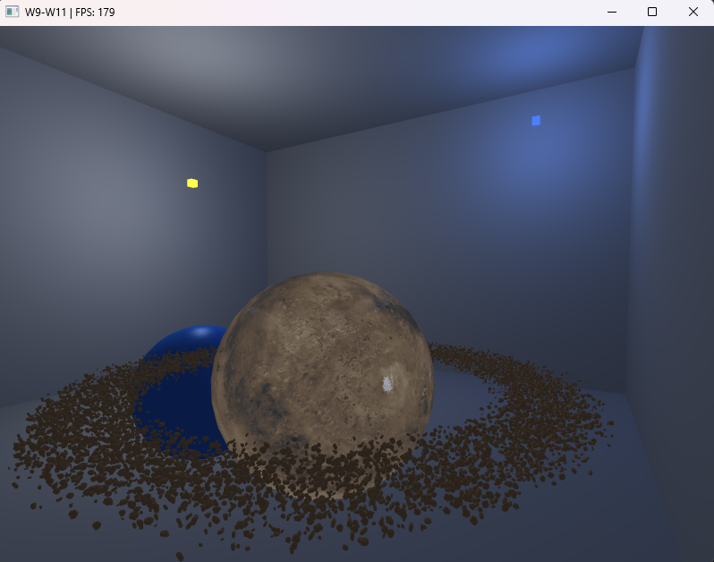
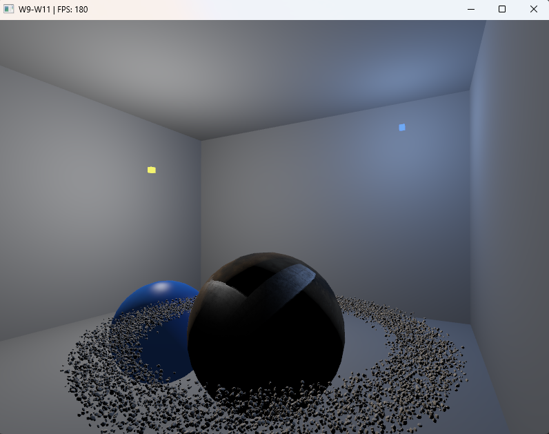
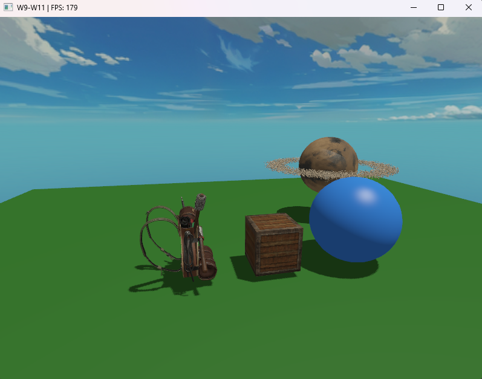

# Week 11 (13.7-19.7.2026)

## I learned:

- how instancing works with models, created a group of asteroids circling a planet to test this out.

- how to gamma correct models, textures and objects in the scene through the correct order of operations in the fragment shaders. 

*image also contains tweaks with the ambiences compared to the upper screenshot, so the comparison isn't as clear*

- how to implement shadows with directional lighting in the skybox scene

## I struggled:

- with implementing the asteroids with the instancing method. First I didn't see the asteroids at all due to trying to implement the changes to "model_fragment.glsl" instead of making a separate shader for the instanced rocks, I wanted to try to make the shader usage more scalable but it didn't work since my model didn't have needed information on the textures (rock model didn't have texture maps). I also tried a few different debugging tactics like removing face culling, but this didn't help either. By using a simple fragment shader I realized that the asteroid creation is working otherwise except for the fragment shader. The fix was to create a fragment shader that didn't deal with texture mapping but only used color based material (however I think there's probably an easier way to get a scalable result on the model_fragment.glsl instead of creating a new one)

- with the order of operations in the gamma correction. Just by simply implementing the default gamma correction (glEnable(GL_FRAMEBUFFER_SRGB)) doesn't work since I have the framebuffer of the rendered objects in the scene. First I ended up with washed out colors that seemed to lack contrast and saturation, since the textures. material colors and framebuffer weren't using the same color space. I fixed this by loading the diffuse textures in sRGB which kept lighting and framebuffer in linear space, and only after that applying the gamma correction in the screen shader. I roughly understand now which elements of the scene should be handled in the linear space and which ones in the sRGB space. If I understood correctly, the pipeline for gamma correction should be like this (in this context): sRGB diffuse texture -> linear colors -> lighting -> linear HDR framebuffer -> tone mapping and gamma encoding.

## Thoughts:

- It was really cool to test increasing the asteroid count and tracking fps performance. After increasing the count to 150k I started noticing drops below 100fps (normally fps stays in the 180fps area).

- Configuring the light space with the shadows was certainly interesting, yet difficult and probably the hardest thing this week. Understanding the depth comparison between the closest and the current fragment was the key. I used AI to help me conceptualize the whole shadowing process which helped me quite a bit.