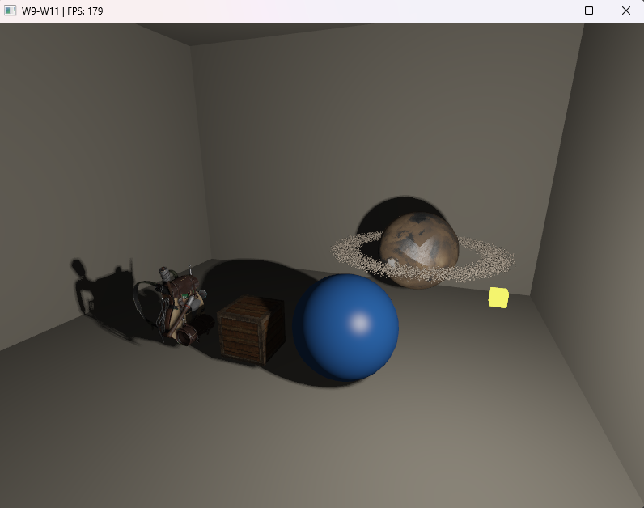
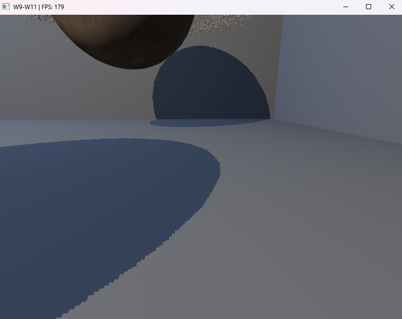
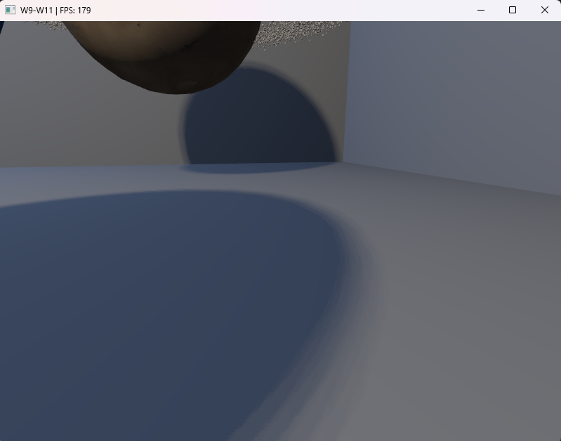

# Week 11 (20.7-26.7.2026)

## I learned:

- how point shadows work. Created this by making a depth cubemap containing six faces of the room scene that each stored depth data(distance from the the point light to the closest surface). Instead of orthographic projection with directional lighting, this time I used perspective projection for each of the six faces.

<table>
  <tr>
    <td align="center">
      
       
      <em>Before PCF</em>
    </td>
    <td align="center">
      
       
      <em>After PCF</em>
    </td>
  </tr>
</table>

- about normal mapping ... --> brickwall stuff here

PICTURE HERE

- how normal mapping is used for optimization of complex models. It was mindblowing to see how effective this little trick can be when normal mapped shadows are added and number of triangles is decreased.

## I struggled:

- with removing jagged shadow edges. First I started using PCF (percentage-closer filtering) with the LearnOpenGL tutorial (Point Shadows chapter), but ended up accidentally producing shadow acne as a result. The reason for this was that I was accidentally also drawing shadows for the wall itself, even though drawLitObjects() was already doing them (in a different way). By removing the drawClosedRoom() function from the drawPointShadowCasters() everything started looking better. I also had to play around the with the point shadow bias and disk radius to get the best fit for the room mode. 

- The sphere had also issues with self-shadowing, it became darker after implementing the point shadows. The fix to this was to discard the front faces of the sphere in the shadow rendering part and only render things from the back faces, playing with face culling functions really worked on this issue.

- with mapping the walls of my room with normal mapped textures. The issue was ... . I fixed it by separating the brick wall to the normal mapped normals in the lighting and geometric (original) normals in the shadow rendering. 

- The issue ??...... The fix was to implement TBN (Tangent, bitangent, normal) matrix.

## Thoughts:

- I was thinking if I should add shadows also for the blue stationary light, but ended not doing it due to so much repetition. I haven't done refactoring of the code in so many weeks that at this point it probably would save a lot of time to make a lot of these repetitious functions more scalable, since at this point the repetition for certain calls and functions is just unnecessary and annoying.