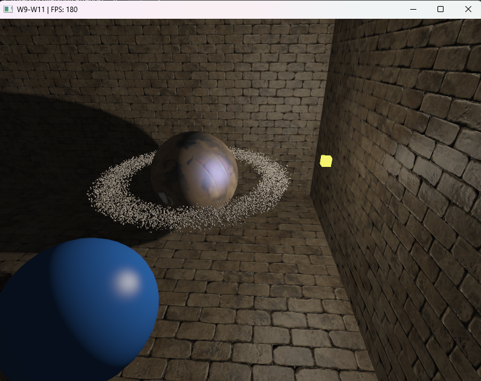

# Week 13 (27.7-2.8.2026)

## I learned:

- to show shadows from other objects on the normal mapped surfaces (like on the brickwall)

- about refactoring graphics scenes in a more proper way. In this case I mostly let AI do its thing and organize the graphics repository into a more reasonable format. Refactoring mainly consisted of remaking the previous `week09_scene.cpp` into a more compact and readable `graphics_scene.cpp`. In addition the folders/file were reorganized and renamed appropriately in order to separate all the different elements of the current scene.

| Area | Before refactoring | After refactoring |
|---|---|---|
| Main scene length | 3862 lines | 1520 lines | 
| Project organization | Everything mixed under `src/common` and `src/week09` | Code is separated into `src/app`, `src/engine` and `src/scenes` |
| Shader organization | Shader files stored with C++ files | 25 shader files are `assets/shaders/scene` and `assets/shaders/skybox` |
| Uniform calls | Many repeated `glUniform` calls | Shared helper functions used for matrices, vectors, textures and lighting values |
| Repeated rendering code | Input handling, transformations, model setup, room rendering and tangent calculations with repeated code | Reusable helpers, shared configuration functions and rendering loops

## I struggled:

- with getting the previous features like debuggers to work with the new features. I should decide on what I want my end product to look like, since now I'm increasingly wasting time on constant and repetitious tweaks on the old feature compabilities. Although I think the refactoring helps on this issue a bit.

## Thoughts:

- The refactoring was long overdue and needed to continue learning further with the current scene. From now on I won't have to repeat so much of the same code and can focus more on the new implementations versus looking for small syntax errors from a code mess.
    - Refactoring is still not perfect, with more effort the amount of files could be reduced since the shaders still have repetitive elements (some shaders are close to identical so there's probably a better way). However I think for now this will do, more thorough refactoring could be implemented when I have a final version of all the functions in this repository.