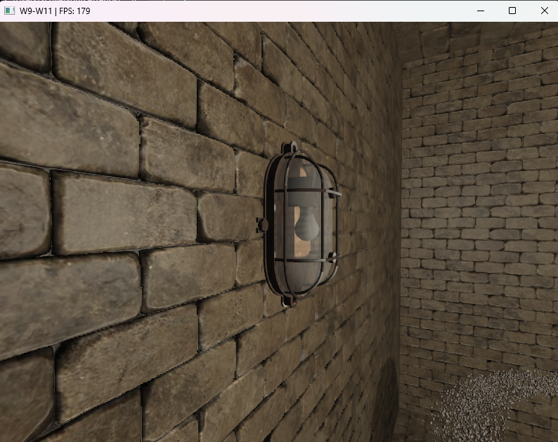

# Week 14 (3.8-9.8.2026)

## I learned:

- reviewed parallax mapping chapter and code from last time. Now I think I have a more clear understanding on what happens with parallax mapping: texture coordinates (UVs) are pushed back according to the depth map through the displacement method. The fragment positions of the wall themselves don't change. The data for the displacement is derived from the view direction that has been converted to tangent space since texture UVs axes live in that space. Basically normal mapping and parallax mapping compliment each other in a nice way since they focus on separate things (normal mapping focuses on the depth that comes from lighting).

- how to work with semi-transparent model mappings. Added compability for this in the model/mesh/fragment shader sections.

## I struggled:

- with making the wall lamp model emit light through semi-transparent glass. I chose a bit of a difficult model to create the lighting on, but since I was already halfway, I stuck with the original one. Also certain surfaces of the model (back wall inside the lamp) don't look as intended.

## Thoughts:

- I could write down somewhere a "weaknesses chart" where I could add concepts that I'm still not that comfortable with after going through the last LearnOpenGL chapters. This could also be useful revision for those concepts.

- Decided that my direction for the project will be creating an observatory room out of my main scene. This concept fits to my project well as I can make the planet/asteroid thing way bigger and then replace one (or all) of the room walls with glass through which you can see to the space. The models I already have implemented in the room could be some kind of artifacts on display underneath the wall lamps.