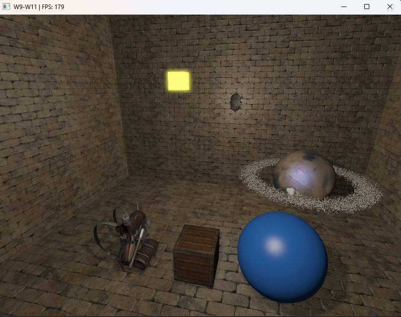
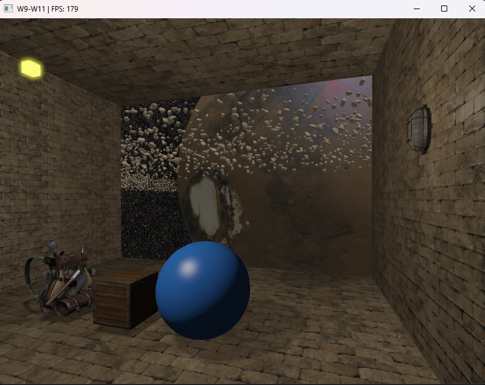

# Week 15 (10.8-17.8.2026)

## I learned:

- about NVIDIA Nsight Graphics, a developer tool that could be used a bit later with more complex scenes. I should test this tool at some point to see if I could gain knowledge from it or perhaps use it in my currect scene in the final stages.

- how to create bloom effect on my lighting. Did this with the help of LearnOpenGL tutorial: first extract bright colors exceeding a certain treshold to a separate frame, then blur the bright parts with two-pass Gaussian blur and finally blend the blurred and normal frames together to create the bloom effect in the lighting.

- started implementing the observatory by using a space skybox and scaling the planet and asteroids up.

- read about deferred shading (a scalable way to have many light sources in a scene at the same time). However in my scene deferred shading is probably going to cause unnecessary complexity without decent trade-offs (since I would have to route every aspect of the scene through the G-Buffer instead), so I'm going to skip its implementation for now.

- SSAO (continue later)

- read about PBR theory. "The reflectance equation is based around irradiance" continue reading from here https://learnopengl.com/PBR/Theory

## I struggled:

- with getting the wall lamp to look as I envisioned. I've tried to debug the lamp a bit now but it seems that it's too much work to actually get it look like it self-illuminates light from the bulb through the glass and would look like the lamp is also lit. I think it might be better to find another simpler model that gets the job done.

- with implementing the shadows from all four stationary wall lamps. Since we use point shadows and render them for the room scene from 6 directions, then with 4 lights we would have render the shadows from 24 directions which would be expensive. However since the lights are stationary, we can probably only render the shadows once instead of doing it every frame. By caching the shadow values and reusing them we avoid possible performance issues. 
    - Even with caching the shadows there's still PCF (shadow edge smoothing) which we might need to decrease down from 20 samples.

## Thoughts:
