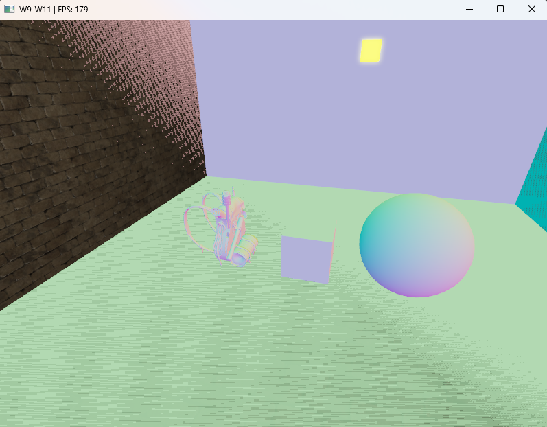
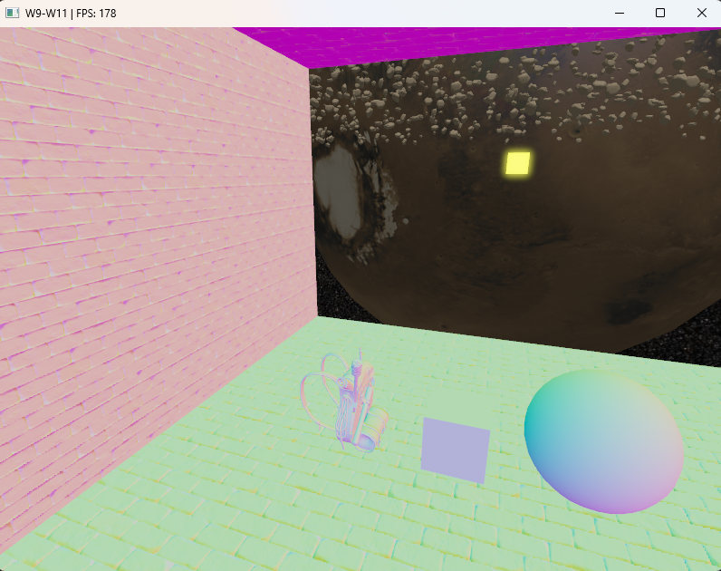

# Week 16 (17.8-23.8.2026)

## I learned:

<table>
  <tr>
    <td align="center">
      
       
      <em>Before</em>
    </td>
    <td align="center">
      
       
      <em>After</em>
    </td>
  </tr>
</table>

## I struggled:

## Thoughts:

- This week has been mostly putting the observatory scene together by fixing remaining bugs and inconsistancies in the code.
